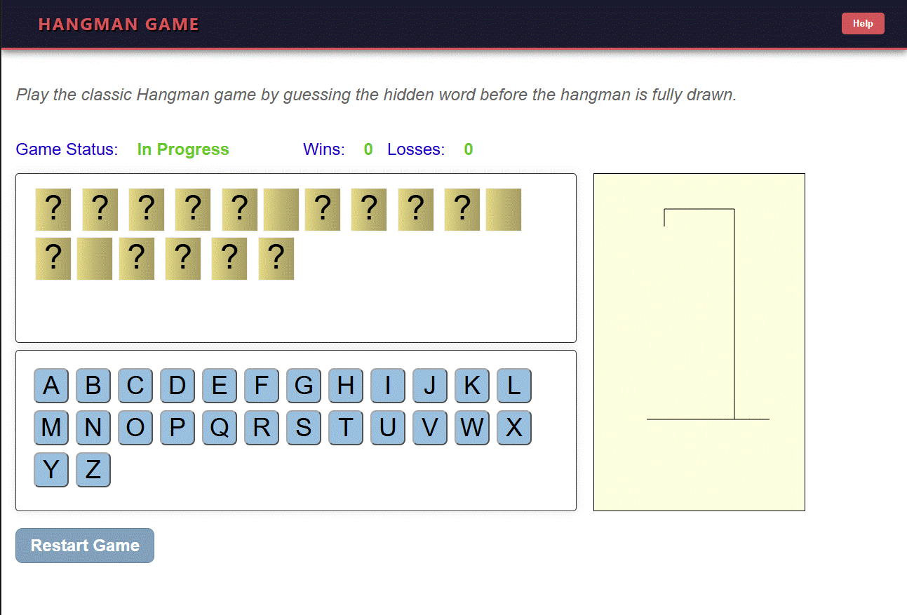

# hangmangame
Web app version of classic Hangman game
## Instructions
To play the classic Hangman game, guess the hidden word before the hangman is fully drawn.
You can use the letters provided to make your guesses. Each incorrect guess adds a part to the hangman drawing.
Guess all the letters in the hidden word before the hangman is fully drawn to win the game.
If the hangman is fully drawn before you guess all the letters, you lose the game.
You can restart the game at any time by clicking the "Restart Game" button.
Good luck and have fun playing Hangman!
## Try It Out!
[Play Hangman Game](https://g2nconnell.github.io/hangmangame/)
## Screenshots

